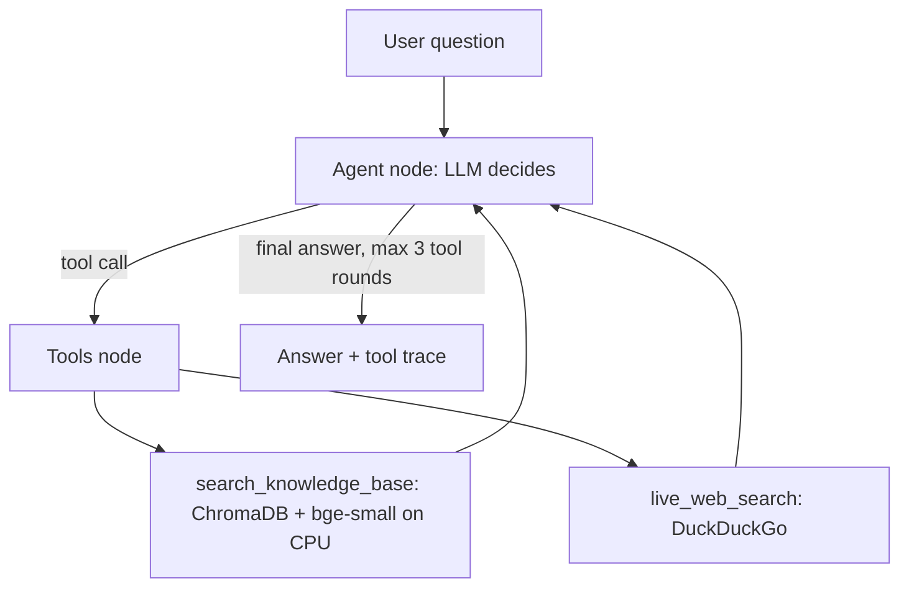

# 🏭 Industrial AI Assistant

An agentic RAG assistant for industrial AI questions. A LangGraph agent decides, for each question, whether to answer directly, search a local knowledge base, or search the live web, and the UI shows every tool call it made.

**Live demo:** https://industrial-agentic-ai-rag.streamlit.app/
*Free hosting: the app may take a minute to wake up, and the demo model's quota is shared between visitors, so you may occasionally see a "rate-limited, try again" message.*

**Status:** Milestone 1 of 5 complete (`v0.1.0`).

## How it works



- **Routing:** the model chooses between a direct answer, the knowledge base and web search. The loop is capped at 3 tool rounds.
- **Knowledge base:** 16 Wikipedia articles on industrial AI (predictive maintenance, quality control, OEE, MLOps, RAG and more), chunked to 480 tokens and embedded with `bge-small-en-v1.5` on the CPU.
- **Two interchangeable model backends**, selected by `ENV_MODE`:
  - `local`: Qwen2.5-3B-Instruct (Q4_K_M) via LM Studio, sized for a 4 GB GPU
  - `cloud`: a Groq-hosted model through the same OpenAI-compatible interface (used by the live demo)
- **Transparency:** each answer has an expandable trace of the tool calls and the raw results behind it.
- **Self-contained start:** the vector index is built automatically on first launch.

## Tech stack

Python 3.12 · LangGraph · LangChain · ChromaDB · sentence-transformers · Streamlit · LM Studio · Groq

## Run locally

```bash
pip install -r requirements-dev.txt
cp .env.example .env          # set ENV_MODE; for cloud mode also set GROQ_API_KEY
python -m streamlit run app.py
```

For local mode, start the LM Studio server on port 1234 with Qwen2.5-3B-Instruct loaded (context length 4096).

## Portfolio API deployment

The portfolio assistant is exposed by `api.py` as a small FastAPI service. Deploy this
repository to Render using the included `render.yaml`, set `GROQ_API_KEY` as a secret,
and keep `ENV_MODE=cloud`. The service builds its Chroma index from the single
`data/docs/profile.txt` file on startup. Set the portfolio build variable
`NEXT_PUBLIC_RAG_API_URL` to the Render service URL before deploying the static site.

The static widget sends JSON `POST /api/chat` requests:

```json
{ "question": "What tech stacks does he use?" }
```

The API responds with `{ "answer": "...", "thread_id": "..." }`. `GET /health` can be
used by the host for health checks.

## ToDo / Limitations

- No conversation memory yet!
- Answers are not yet checked automatically against their sources; use the tool trace to verify claims.
- Web search returns short snippets, so answers about fast-moving topics can be thin.
- Small local models are less reliable than the cloud model at tool selection and at summarizing web results.

## Roadmap

| Milestone | Focus | Status |
|---|---|---|
| 1 | Baseline agent, tools, local + cloud model routing, deployment | ✅ Done |
| 2 | Multi-turn memory, context trimming, semantic cache | Planned |
| 3 | Evaluation: retrieval metrics, LLM-as-judge faithfulness, latency benchmarks | Planned |
| 4 | Self-correcting RAG: document grading, query rewriting, token streaming | Planned |
| 5 | FastAPI backend, Docker, CI, resilient model fallback | Planned |

## Data attribution

The knowledge-base documents are Wikipedia articles, licensed under CC BY-SA 4.0. Each file in `data/docs/` keeps its source URL at the top.